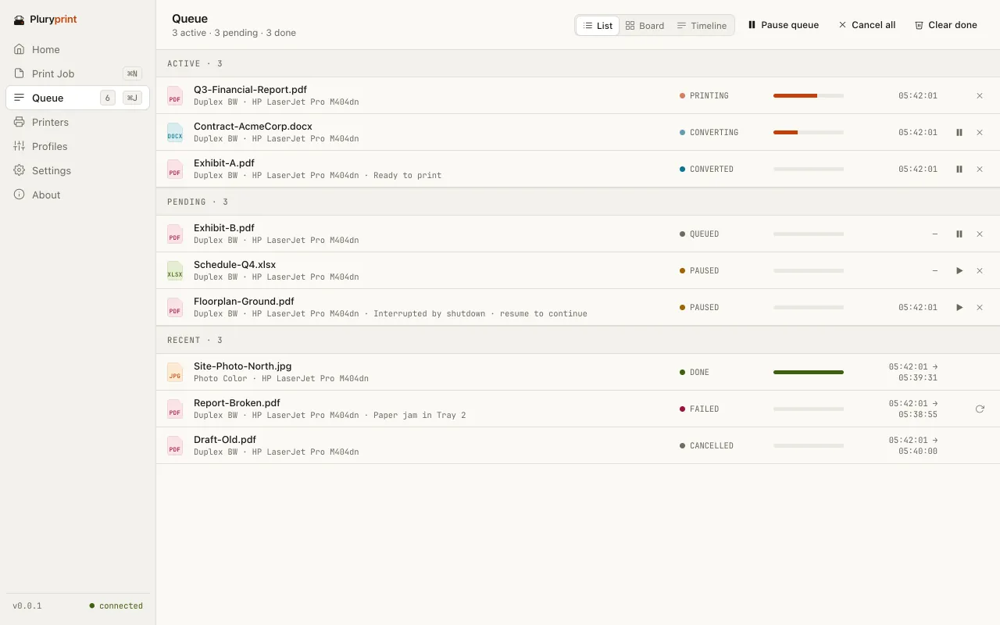
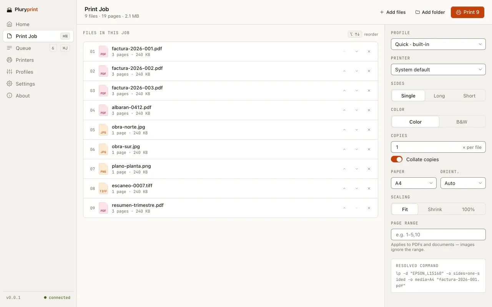
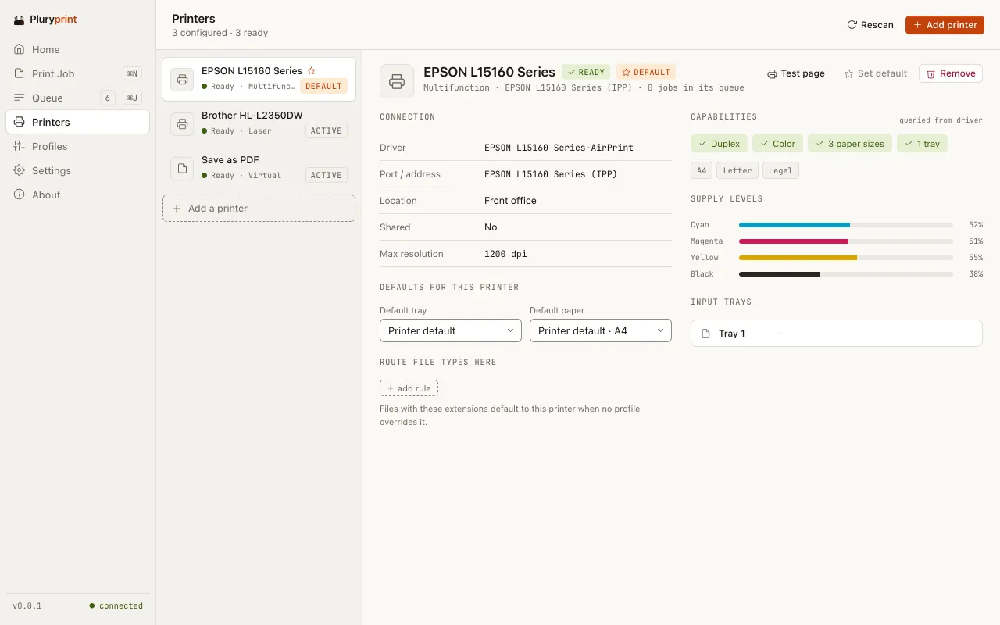
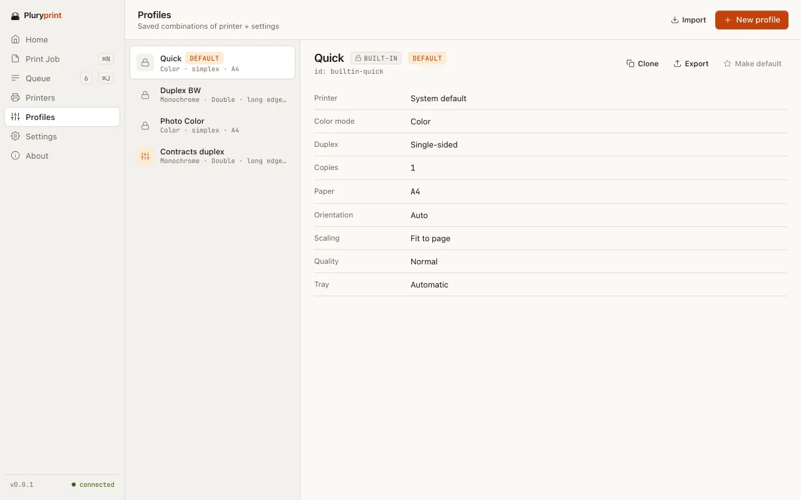

<div align="center">


# Pluryprint

**Select 5, 50 or 500 files. Print them all.**

Free batch printing for Windows, macOS and Linux. No 15-file limit, no Adobe and no $149 licence.

Free · No account · No telemetry · AGPL-3.0

[Website](https://pluryprint.maecly.com/en/) ·
[Download](https://github.com/MAECLY/pluryprint/releases/latest) ·
[Docs](./docs/README.md) ·
[Changelog](./CHANGELOG.md) ·
[Report a bug](https://github.com/MAECLY/pluryprint/issues/new/choose) ·
[Sitio en español](https://pluryprint.maecly.com/)

[](https://github.com/MAECLY/pluryprint/releases/latest)
[](https://github.com/MAECLY/pluryprint/releases)
[](https://github.com/MAECLY/pluryprint/stargazers)
[](https://hits.sh/github.com/MAECLY/pluryprint/)
[](./LICENSE)
[](https://github.com/MAECLY/pluryprint/actions/workflows/ci.yml)
[](https://github.com/MAECLY/pluryprint/commits/main)
[](https://tauri.app)

</div>

> [!WARNING]
> **Pre-alpha.** Expect rough edges. The installers are not signed with Apple or
> Microsoft certificates, so Windows and macOS warn the first time you open
> them: see [First launch](#first-launch). Linux is a preview: built and tested
> in CI, not yet on real machines.

<p align="center">
  <picture>
    <source media="(prefers-color-scheme: dark)" srcset="./.github/assets/readme/queue-dark.webp">
    <source media="(prefers-color-scheme: light)" srcset="./.github/assets/readme/queue-light.webp">
    
  </picture>
</p>

## Contents

- [Why Pluryprint](#why-pluryprint)
- [Features](#features)
- [Download](#download)
- [First launch](#first-launch)
- [Usage](#usage)
- [Integrations](#integrations)
- [Supported files](#supported-files)
- [Privacy](#privacy)
- [What it doesn't do yet](#what-it-doesnt-do-yet)
- [FAQ](#faq)
- [Build from source](#build-from-source)
- [Documentation](#documentation)
- [Contributing](#contributing)
- [Security](#security)
- [Acknowledgements](#acknowledgements)
- [License and trademarks](#license-and-trademarks)

## Why Pluryprint

**Past the fifteen-file wall.** Select more than about 15 files in Windows and
**Print** disappears from the menu. The paid fixes cost $79.95 to $149; the free
ones are abandoned or print PDFs only.

Pluryprint takes the whole selection, 5 files or 500, and turns it into one job
with one set of print settings.

- **macOS, today:** Finder › Services › “Print with Pluryprint”, or with the
  default profile. Built into the app; no extension to enable.
- **Windows, with the installer:** an Explorer submenu, with no file limit. On
  Windows 11 it is under “Show more options”.
- **Linux (preview), with the .deb:** “Open with › Pluryprint” in any file
  manager, plus “Print now”, “Configure print job…” and “Add to print queue” in
  Dolphin (a Pluryprint submenu) and Nemo. The AppImage gets “Open with” once
  you integrate it with your desktop.
- **Everywhere:** drag files or folders onto the window, with or without
  subfolders.

The Windows Explorer submenu:

```text
Right-click on any number of files → Pluryprint ▸
                                       ├─ Print 12 files          (default profile)
                                       ├─ Print with “Duplex BW”  (one row per profile, up to 8)
                                       ├─ Print with “Photo Color”
                                       ├─ Configure print job…
                                       └─ Add to print queue
```

### How it compares

List prices in USD for one user, from each vendor’s website when we did our
research (2026). They may have changed: check them before you decide. A dash:
not stated.

| Feature                   | Pluryprint                                                                     | Print Conductor                            | 2Printer          | Batch & Print Pro         | FolderMill             |
| ------------------------- | ------------------------------------------------------------------------------ | ------------------------------------------ | ----------------- | ------------------------- | ---------------------- |
| Price                     | $0                                                                             | $149 (volume pricing down to $59 per user) | $149              | $79.95 (Premium, $109.95) | Quote (for businesses) |
| Open source               | AGPL-3.0                                                                       | No                                         | No                | No                        | No                     |
| Formats                   | 27 extensions (Office and OpenDocument need LibreOffice)                       | 90+                                        | 90+               | 30+                       | 90+                    |
| From the right-click menu | Finder › Services and Explorer, yes (on Windows 11, under “Show more options”) | Explorer menu (adds files to its window)   | No (command line) | No                        | No (hot folders)       |
| Command line              | Yes, with `--json`                                                             | Partial                                    | Yes               | Yes                       | No                     |
| macOS                     | Yes                                                                            | No                                         | No                | No                        | No                     |
| Linux                     | Yes (preview)                                                                  | No                                         | No                | No                        | No                     |
| Account or telemetry      | None                                                                           | —                                          | —                 | —                         | —                      |

**Where others are ahead:** many more formats, years of use and published
releases. Print Conductor already plugs into the Windows Explorer menu.
**The difference:** free and AGPL, it prints straight from the menu with a
profile instead of only loading files into another window, and it has a native
entry in Finder’s Services.

<sub>Sources:
[Print Conductor](https://www.fcoder.com/products/print-conductor),
[Print Conductor’s Explorer menu guide](https://www.print-conductor.com/how-to/load-list-of-files-for-printing),
[2Printer](https://www.cmd2printer.com/),
[Batch & Print Pro](https://www.batch-print.com/),
[FolderMill](https://www.foldermill.com/),
[gHacks](https://www.ghacks.net/?p=141087).</sub>

## Features

**It all happens on your machine.** No account, no cloud, no telemetry. Every
file becomes a PDF on your computer and goes straight to your printer.

- **27 extensions.** PDFs (password-protected ones too), images, SVG, text, HTML
  and Markdown, inside the app and with no network access. Office and
  OpenDocument need LibreOffice, HEIC on Windows the Microsoft Store codecs and
  on Linux a HEIF decoder (libheif or ImageMagick): if they are missing, the
  app offers to install them, always asking first (on Linux it tells you which
  package to install).
- **Named profiles.** Copies, collation, duplex, colour or grayscale, paper,
  orientation, scaling, page ranges, tray and quality. Three built in and as
  many of your own as you like, to import and export.
- **A queue that drops nothing.** Saved on disk and recovered after a crash.
  Transient errors are retried three times (1, 5 and 25 s); if a tool is
  missing, the printer cannot do a setting or a PDF needs its password, the job
  pauses and tells you what to do.
- **A command line for scripts.** `print`, `printers`, `profiles`, `queue` and
  `update`, with `--help` on each, `--json` output and fixed exit codes. It
  opens no window. See [Usage](#usage).

<p align="center">
  <picture>
    <source media="(prefers-color-scheme: dark)" srcset="./.github/assets/readme/job-dark.webp">
    <source media="(prefers-color-scheme: light)" srcset="./.github/assets/readme/job-light.webp">
    
  </picture>
  <br>
  <sub>One job with nine files. Bottom right, the exact command sent to the printer.</sub>
</p>

### A screen for every step

Seven screens: Home, Print Job, Queue, Printers, Profiles, Settings and About.

- **Queue.** Two conversions at once by default (up to eight, in Settings) and
  one print at a time. Pause, resume or cancel one job or the whole queue, and
  see it as a list, a board or a timeline. A job is followed in the system
  queue until it prints; one the system did not confirm ends as “unconfirmed”,
  never as printed.
- **Printers.** The system’s printers, with their status, capabilities and
  supply levels. Find network printers through mDNS or add one by IP, and send
  each file type to a different printer.
- **Profiles.** Quick, Duplex BW and Photo Color come built in. Create, clone,
  edit and set a default; delete one and you have five seconds to undo it.

<table>
  <tr>
    <td width="50%">
      <picture>
        <source media="(prefers-color-scheme: dark)" srcset="./.github/assets/readme/printers-dark.webp">
        <source media="(prefers-color-scheme: light)" srcset="./.github/assets/readme/printers-light.webp">
        
      </picture>
    </td>
    <td width="50%">
      <picture>
        <source media="(prefers-color-scheme: dark)" srcset="./.github/assets/readme/profiles-dark.webp">
        <source media="(prefers-color-scheme: light)" srcset="./.github/assets/readme/profiles-light.webp">
        
      </picture>
    </td>
  </tr>
</table>

Also: drag and drop · folders with subfolders · resolved command shown · warns
when a printer cannot do duplex or colour · password-protected PDFs · test page ·
organisation policy · system notifications · keyboard shortcuts · light, dark or
system theme · in English and Spanish.

## Download

Get the installer for your computer from the
**[latest release](https://github.com/MAECLY/pluryprint/releases/latest)**, or
from the [website’s download section](https://pluryprint.maecly.com/en/#status),
which always links the current files.

| Computer                                | File                  | Notes                                                                                                          |
| --------------------------------------- | --------------------- | -------------------------------------------------------------------------------------------------------------- |
| Windows 10 and 11 · x64 (Intel or AMD)  | `.exe`                | Built and tested in CI. Per-user installer, no administrator rights. Not yet tried on a Windows 10 machine.    |
| Windows 11 · ARM64 (Snapdragon)         | `.exe`                | Its own installer, tested on Windows 11 on ARM. The x64 one also works there, emulated.                        |
| macOS 13 or later · Apple silicon (M1+) | `.dmg`                | Built and tested in CI.                                                                                        |
| macOS 13 or later · Intel               | `.dmg`                | Tested only under Rosetta 2 on an Apple silicon Mac, not yet on an Intel Mac.                                  |
| Linux · x64 (preview)                   | `.AppImage` or `.deb` | Built in CI and unit-tested there; not yet run on a real machine. Ubuntu 22.04, Debian 12, Fedora 38 or later. |
| Linux · ARM64 (preview)                 | `.AppImage` or `.deb` | Built and fully tested in CI (with a CUPS PDF queue); not yet run on a real machine.                           |

**Right-click. Print everything.** In Finder, from Services; in Explorer, from
the submenu the installer registers.

The Windows installers register the Explorer menu and include SumatraPDF, which
Pluryprint prints PDFs with. On macOS, drag Pluryprint to Applications. On
Linux, install the `.deb` on Debian, Ubuntu and their derivatives
(`sudo apt install ./Pluryprint_<version>_linux_x64.deb`, keep the `./`); it
depends on the CUPS client tools and adds the file-manager entries. On any
other distribution, make the AppImage executable (`chmod +x`) and run it; it
needs FUSE's `fusermount3` (the `fuse3` package, already there on most
desktops). Both update from inside the app.

## First launch

Pluryprint has no Apple or Microsoft certificates yet
([ADR-0011](./docs/adr/0011-release-channel.md)), which is why SmartScreen and
Gatekeeper warn. Each release’s notes explain it step by step.

1. **Check the download first** against
   [`SHA256SUMS`](https://github.com/MAECLY/pluryprint/releases/latest/download/SHA256SUMS),
   saved in the same folder as the installer:

   ```sh
   # macOS
   shasum -a 256 -c SHA256SUMS --ignore-missing
   ```

   ```sh
   # Linux
   sha256sum -c SHA256SUMS --ignore-missing
   ```

   ```powershell
   # Windows: compare the hash with the installer's line in SHA256SUMS
   Get-FileHash .\Pluryprint_*_windows_*.exe -Algorithm SHA256
   ```

2. **Windows:** SmartScreen will say “Windows protected your PC”; choose
   **More info › Run anyway**. If Smart App Control blocks it, there is no
   button to continue: only turning it off, which cannot be undone without
   reinstalling Windows.
3. **macOS:** if it says Apple could not verify it, go to **System Settings ›
   Privacy & Security › Open Anyway**. On macOS 15 or later, Control-click ›
   Open no longer gets past it. The app is ad-hoc signed and not notarized; if
   you prefer the terminal:
   `xattr -dr com.apple.quarantine /Applications/Pluryprint.app`.
4. **Linux:** there is no warning to get past. A `.deb` update asks for your
   administrator password, as installing it did.

**Updates are signed.** The app tells you when there is a new version and you
choose: install now (signature verified, no administrator rights), remind me
later or skip that version. It never updates by itself. There are two
channels, stable and beta.

## Usage

1. Install Pluryprint.
2. Select the files (or folders) in Explorer or Finder and right-click:
   - **Windows:** the Pluryprint submenu. On Windows 11 it is under “Show more
     options” (or Shift+F10). It does not appear when Explorer runs elevated.
   - **macOS:** Services › “Print with Pluryprint”, or “Print with Pluryprint
     (default profile)”.
   - **Linux (.deb):** “Open with › Pluryprint” anywhere; in Dolphin, the
     Pluryprint submenu; in Nemo, “Print now with Pluryprint” and its two
     companions.
3. On Windows, choose **Print N files**, a **Print with “profile”** row, or
   **Configure print job…** to review every setting first. On macOS, “Print
   with Pluryprint” opens the Print Job screen and “(default profile)” prints
   straight away.
4. Follow the jobs in the **Queue**.

You can also drag files or folders onto the app window.

### From a script

The command line ships with the app. On Windows it is a separate console
executable next to the app, `pluryprint-cli.exe`, so scripts see its exit code;
on macOS it is `Pluryprint.app/Contents/MacOS/pluryprint-cli`. It is not added
to `PATH` there yet: call it by the executable’s path. The Linux `.deb` puts
`pluryprint` on `PATH`; an AppImage is the command itself
(`./Pluryprint_<version>_linux_x64.AppImage print …`). The command name may change
before the first stable release.

Output shortened:

```console
$ pluryprint-cli print --files "invoices/*.pdf" --profile "Duplex BW" --json
{ "batch_id": "…", "printer": "HP LaserJet Pro M404dn", "profile_name": "Duplex BW",
  "files": [ { "path": "invoices/2026-001.pdf", "state": "done" }, { "path": "invoices/2026-002.pdf", "state": "done" } ],
  "exit_code": 0 }
```

Password-protected PDFs take `--password-file` or `--password-stdin`. Every
option, the JSON output and the exit codes are in
[ipc-and-cli.md](./docs/04-architecture/ipc-and-cli.md).

## Integrations

### Pluryfact (in development)

[Pluryfact](https://pluryfact.maecly.com/) is a browser extension that
downloads your electronic invoices from Ecuador's SRI. Once both apps are
connected, Pluryfact can send what it downloaded (the RIDEs in PDF, the
vouchers' XML and its TXT report) straight to Pluryprint, which opens them on
the Print Job screen marked **From Pluryfact**, with the settings you chose
in Pluryfact filled in. Nothing prints until you confirm, unless you chose
"print right away" in Pluryfact.

How it works: Pluryfact talks to a small helper that ships with Pluryprint,
`pluryprint-bridge`, through the browser's Native Messaging. The browser
starts the helper only for Pluryfact. No port is opened and nothing goes over
the network: the documents travel from the browser to Pluryprint on your
machine, are checked (size, checksum, type) and kept in Pluryprint's data
folder for a week. Chrome, Edge, Brave and Chromium on Windows and macOS. The
Windows installer registers the helper; on macOS Pluryprint registers it each
time it opens. **Settings → Browser integration** shows the state per browser
and can reconnect them; `pluryprint-cli bridge status` does the same from a
script.

This arrives with Pluryprint 0.0.6 and Pluryfact 0.2. Design and protocol:
[ADR-0016](./docs/adr/0016-pluryfact-browser-bridge.md) and
[ipc-and-cli.md §6](./docs/04-architecture/ipc-and-cli.md#6-browser-bridge-native-messaging).

## Supported files

| Kind                    | Extensions                                     | How                                                                                                                                                                          |
| ----------------------- | ---------------------------------------------- | ---------------------------------------------------------------------------------------------------------------------------------------------------------------------------- |
| PDF                     | PDF                                            | Printed as-is after a structural check. Password-protected PDFs too.                                                                                                         |
| Images                  | JPG, JPEG, PNG, TIF, TIFF, BMP, WebP           | Converted in the app (transparency on white).                                                                                                                                |
| Vector                  | SVG, SVGZ                                      | Vector PDF pages, in the app.                                                                                                                                                |
| Text                    | TXT, HTML, HTM, MD, MARKDOWN                   | In the app, paginated by the system web view with scripts and network off.                                                                                                   |
| HEIC                    | HEIC, HEIF                                     | `sips` on macOS; the Microsoft Store HEIF and HEVC codecs on Windows; libheif's `heif-convert` or ImageMagick, installed separately, on Linux.                               |
| Rich text               | RTF                                            | `textutil` on macOS; LibreOffice on Windows and Linux.                                                                                                                       |
| Office and OpenDocument | DOCX, DOC, XLSX, XLS, PPTX, PPT, ODT, ODS, ODP | LibreOffice, installed separately (the app offers to install it).                                                                                                            |
| XML                     | XML                                            | In the app. Ecuadorian SRI electronic receipts (all six types) print as a RIDE-like page with the access-key barcode; any other XML as a readable tree. No DTD is ever read. |

Not supported: GIF (refused with a note to convert it to PNG or JPEG), EPUB,
email (EML, MSG), CAD, PostScript and archives. Details in
[supported-formats.md](./docs/03-requirements/supported-formats.md).

## Privacy

No account, no cloud, no telemetry. Pluryprint converts and prints on your
machine, and a document it prints cannot reach the network. The only internet
traffic is the update check (at startup, at most once a day, or from About), an
update download you start, and a missing-tool install you confirm. Finding
printers (mDNS) stays on your local network, and print output goes only to the
printer you chose. See [privacy.md](./docs/09-legal/privacy.md).

## What it doesn't do yet

- On Windows 11, the Explorer menu entry is only under “Show more options”: the
  top-level menu needs a signed package, and there is no certificate yet
  ([ADR-0013](./docs/adr/0013-explorer-command-per-user-verb.md)).
- Office and OpenDocument (and RTF on Windows and Linux) need LibreOffice, HEIC
  on Windows the Microsoft Store codecs and on Linux a HEIF decoder. They do
  not come with the app: it offers to install them (on Linux, it names the
  package) and does nothing until you confirm.
- No GIF, EPUB, email, CAD or PostScript.
- A PDF whose permissions forbid printing is refused, even if you know its
  password.
- On Windows, Draft or High quality is applied only when the printer’s driver
  offers it; if it does not, the command preview says so.
- English and Spanish only.
- Not built: N-up, watermarks, separator pages, hot folders, a Windows service
  mode, a plugin API or file-list import.
- Linux is a preview: built and tested in CI, not yet on real machines (and
  Wayland not tried at all). Nautilus (GNOME Files) gets only “Open with”, and
  an AppImage adds no right-click entry by itself. Its bundled WebKitGTK only
  updates with Pluryprint, so prefer the `.deb` on Debian and Ubuntu.

Where it is heading: the [roadmap](./docs/06-roadmap/milestones.md) and the
[changelog](./CHANGELOG.md).

## FAQ

<details>
<summary><strong>Is it really free?</strong></summary>

Yes. It costs $0, needs no account and has no paid tier. It is licensed
AGPL-3.0.

</details>

<details>
<summary><strong>Do my files leave my computer?</strong></summary>

No. Everything is converted and printed on your machine; see [Privacy](#privacy).

</details>

<details>
<summary><strong>Do I need Adobe?</strong></summary>

No. PDFs are printed as they are after a structural check, and images are
converted to PDF inside the app. On Windows, printing uses SumatraPDF, which the
installer includes; if it is not found, the job pauses and tells you.

</details>

<details>
<summary><strong>Why does Word need LibreOffice?</strong></summary>

Because every file is turned into a PDF before it is printed, and for Word,
Excel, PowerPoint and OpenDocument (and RTF on Windows and Linux) Pluryprint uses
LibreOffice, which you install separately. If it is missing, the job pauses and
the app offers to install it (with winget, Homebrew or the official website),
always after asking you. Images, SVG, text, HTML and Markdown need nothing: they
are converted inside the app, with no network access.

</details>

<details>
<summary><strong>Is there a file limit?</strong></summary>

Not on the number of files. There is a maximum file size, which you can change
in Settings.

</details>

<details>
<summary><strong>What if a file fails?</strong></summary>

If the error is transient, it is retried three times, after 1, 5 and 25
seconds; if it still fails, or if conversion or printing runs out of time, it
stays in the queue with the reason. If a tool is missing or the printer cannot
do a setting, the job pauses and tells you what to do. Formats it cannot handle,
such as GIF, come back with an explanation.

</details>

<details>
<summary><strong>Does it print password-protected PDFs?</strong></summary>

Yes. Pluryprint detects the encrypted PDF, pauses the job and asks for the
password in the queue; from the command line, with `--password-file` or
`--password-stdin`. It uses the password for that job only and does not save
it. A PDF whose permissions forbid printing is refused.

</details>

<details>
<summary><strong>Does it work from the right-click menu?</strong></summary>

On macOS, yes: select the files in Finder and choose Services › Print with
Pluryprint. On Linux, the `.deb` adds “Open with” everywhere and the three
actions to Dolphin and Nemo. On Windows, the installer registers the Explorer submenu (print N
files, print with a profile, configure the job or add it to the queue): it is
meant for the Windows 10 menu (not yet tried on a Windows 10 machine) and, on
Windows 11, appears under “Show more options”. A top-level entry in the
Windows 11 menu needs a signed package, and there is no certificate yet.

</details>

<details>
<summary><strong>Does it run on Apple silicon, Windows ARM or Linux?</strong></summary>

Apple silicon, yes: that is where it is tested in CI. Windows ARM64 too: it has
its own installer, tested on Windows 11 on ARM, which registers the Explorer
menu. Intel Macs have their own .dmg, tested only under Rosetta 2, not yet on an
Intel Mac. Linux x64 and ARM64 are a preview, as an AppImage and a `.deb`
each: ARM64 is fully tested in CI and x64 unit-tested, neither yet on a real
machine. They need Ubuntu 22.04, Debian 12, Fedora 38 or later, with CUPS.

</details>

<details>
<summary><strong>Why will Windows and macOS warn when I open it?</strong></summary>

Because Pluryprint is not signed with Apple or Microsoft certificates yet.
[First launch](#first-launch) shows how to get past the warning; updates are
signed with the project’s own key and checked before they install.

</details>

## Build from source

You need Rust stable (1.90 or later), Node 24 LTS (the minimum is 22.22.2) with
pnpm 9, and the platform’s native build tools: Visual Studio Build Tools 2022 with “Desktop
development with C++” on Windows, the Xcode Command Line Tools on macOS, and on
Linux (Ubuntu 22.04 or later) `libwebkit2gtk-4.1-dev`, `libgtk-3-dev`,
`libdbus-1-dev` and `librsvg2-dev`. The full checklist is in [local-setup.md](./docs/08-development/local-setup.md).

```sh
git clone https://github.com/MAECLY/pluryprint.git
cd pluryprint
pnpm install
pnpm tauri dev   # the real app, with hot reload
```

- `pnpm dev` runs only the web preview: every screen renders, but with no
  Tauri host the IPC calls fail, so use it for layout work only.
- `make check` runs the same lint, format, type-check, test and clippy gates CI
  runs, on your OS; run it before a pull request (`make help` lists the other
  targets).
- `pnpm tauri build --config src-tauri/tauri.ci.conf.json` produces an
  unsigned bundle under `src-tauri/target/release/bundle/`. The override turns
  off the signed updater artifacts, which need the release key. On Windows,
  first run `scripts\fetch-sumatrapdf.ps1` and
  `scripts\build-shell-ext.ps1 -Arch all`: see
  [installer-windows.md](./docs/07-build-and-release/installer-windows.md).
- The Explorer menu DLL is a separate crate (Windows only): see
  [shell-ext-win/README.md](./shell-ext-win/README.md) and
  [installer-windows.md](./docs/07-build-and-release/installer-windows.md).

<details>
<summary>Stack</summary>

Tauri 2 with a Rust backend and a React + TypeScript + Vite + Tailwind CSS
frontend. Printing goes through the bundled SumatraPDF on Windows and CUPS
(`lp`) on macOS and Linux. Images become PDF in Rust (`image`, `printpdf`, `lopdf`); SVG
through `usvg` + `svg2pdf` in an isolated worker process; HTML, Markdown
(`pulldown-cmark`) and text are paginated by the system web view (WebView2,
WebKit or WebKitGTK) in a second worker, with scripts and network off. Explorer integration
is a per-user `IExplorerCommand` COM DLL; Finder integration is an `NSServices` provider
inside the app. Updates use the Tauri updater with minisign-signed manifests on
GitHub Releases. Reasons in [tech-stack.md](./docs/04-architecture/tech-stack.md)
and the [ADRs](./docs/adr/README.md).

</details>

## Documentation

Everything lives under [`docs/`](./docs/README.md). Good places to start:

- [Product vision](./docs/01-vision/product-vision.md) and
  [value proposition](./docs/01-vision/value-proposition.md)
- [System architecture](./docs/04-architecture/system-architecture.md)
- [MVP features](./docs/05-features/mvp-features.md)
- [Roadmap and milestones](./docs/06-roadmap/milestones.md)
- [Architecture decision records](./docs/adr/README.md)
- [Releasing](./docs/07-build-and-release/releasing.md)

## Contributing

Pull requests are welcome. Read [CONTRIBUTING.md](./CONTRIBUTING.md) and the
[full guide](./docs/08-development/contributing.md), follow the
[Code of Conduct](./CODE_OF_CONDUCT.md), and agree to the
[Contributor License Agreement](./CLA.md): you keep the copyright in what you
write. For anything non-trivial, open an
[issue](https://github.com/MAECLY/pluryprint/issues/new/choose) first so we can
agree on the approach. Translations are welcome too: see
[Translations](./docs/08-development/contributing.md#translations).

## Security

Please do not report vulnerabilities in a public issue. Email
security@maecly.com; [SECURITY.md](./SECURITY.md) has the details and response
times.

## Acknowledgements

Pluryprint stands on these open-source projects:

- [Tauri](https://tauri.app), [Rust](https://www.rust-lang.org/) and
  [React](https://react.dev/)
- [SumatraPDF](https://www.sumatrapdfreader.org/), for PDF printing on Windows
- [LibreOffice](https://www.libreoffice.org/), for Office and OpenDocument
- [resvg/usvg](https://github.com/linebender/resvg),
  [svg2pdf](https://github.com/typst/svg2pdf),
  [pulldown-cmark](https://github.com/pulldown-cmark/pulldown-cmark),
  [lopdf](https://github.com/J-F-Liu/lopdf) and the
  [image](https://github.com/image-rs/image) crate

The full list and licences: [THIRD-PARTY-NOTICES.md](./THIRD-PARTY-NOTICES.md)
and [third-party-licenses.md](./docs/09-legal/third-party-licenses.md).

## License and trademarks

Pluryprint is free software under the
[GNU Affero General Public License v3.0 only](./LICENSE) (`AGPL-3.0-only`).
What that means in practice: [license.md](./docs/09-legal/license.md). For a
commercial licence, write to hola@maecly.com.

“Pluryprint”, its wordmark and the Abanico mark belong to MAECLY and are not
covered by the AGPL-3.0: forks must rebrand. See [TRADEMARKS.md](./TRADEMARKS.md)
and the [trademark policy](./docs/09-legal/trademark.md).

Made by MAECLY. Fewer formats, printed very well.
